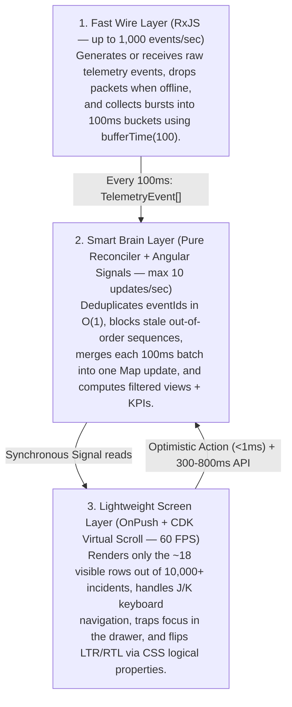
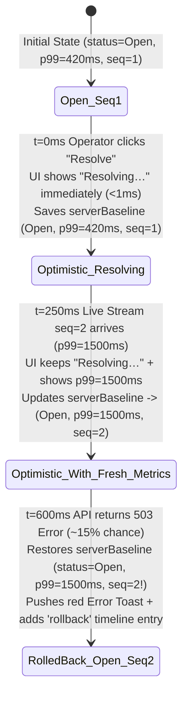

# How Aegis Ops Works — Step-by-Step Runtime Walkthrough

This guide explains **exactly how the application works under the hood**, tracing real data, millisecond timelines, and concrete before/after state snapshots from startup to user interaction.

---

## 1. The 30-Second Mental Model

Think of **Aegis Ops** as three decoupled layers working at different speeds so the browser never drops below **60 FPS**:



---

## 2. Lifecycle 1: What Happens When the App Boots (`t = 0ms`)

1. **Route Mounts the Console:**
   - `src/main.ts` bootstraps `App` (`src/app/app.ts`), and Angular Router mounts `IncidentConsolePageComponent` (`src/app/features/incident-console/incident-console-page.component.ts`).
2. **10,000 Incidents Are Seeded in Memory:**
   - `ngOnInit()` calls `this.store.initializeConsole(10_000)`.
   - `IncidentStreamSimulatorService.generateSeedIncidents(10_000)` creates 10,000 realistic incidents (`INC-10000` down to `INC-00001`) with services, regions, severities, latencies, and sequence numbers, storing them in `incidentMapState` (`Map<string, Incident>`).
3. **Why 10,000 Rows Don't Freeze the DOM:**
   - `IncidentVirtualTableComponent` uses `<cdk-virtual-scroll-viewport itemSize="52">`.
   - Even though `store.filteredIncidents()` holds **10,000 objects in JavaScript memory**, Angular CDK measures the screen height (e.g., `800px`), divides by `52px` row height, and creates **only ~20 `<div>` row elements** in the actual DOM.
   - As you scroll (or press `J`/`K`), CDK recycles those ~20 DOM nodes seamlessly.
4. **Live Samplers Start:**
   - `IncidentStreamSimulatorService.startEngine()` starts the `20ms` telemetry tick timer.
   - `TelemetryStoreService.startPerformanceSampler()` starts a `requestAnimationFrame` loop to measure real browser FPS and updates the header KPI strip once per second.

---

## 3. Lifecycle 2: How `1,000 Events/Sec` Runs Without Lag (Backpressure)

Suppose you click **`Burst (1000/s)`** in the Chaos Toolbar. Here is the exact millisecond-by-millisecond execution trace:

| Time | What Happens in RxJS (`IncidentStreamSimulatorService`) | What Happens in Angular Signals & DOM (`TelemetryStoreService`) |
| :--- | :--- | :--- |
| `t = 20ms` | Timer ticks → emits **20** raw `TelemetryEvent`s into `rawEventSubject`. | **Nothing!** `bufferTime(100)` holds them quietly in an array. |
| `t = 40ms` | Timer ticks → emits **20** more events (40 buffered). | **Nothing!** Browser main thread is 100% free for smooth scrolling. |
| `t = 60ms` | Timer ticks → emits **20** more events (60 buffered). | **Nothing!** |
| `t = 80ms` | Timer ticks → emits **20** more events (80 buffered). | **Nothing!** |
| `t = 100ms` | Timer ticks → emits **20** more events → **`bufferTime(100)` flushes `[100 events]`!** | `store.ingestBatch(batch)` loops through all 100 events in `<1ms`, clones the `Map` **once**, and calls `incidentMapState.set(nextMap)` **once**. |

### Why this matters
- **Without `bufferTime(100)`:** Angular would clone a 10,000-entry `Map` and re-sort/re-filter 10,000 incidents **1,000 times per second** → UI freezes completely.
- **With `bufferTime(100)`:** Angular updates Signals **10 times per second** (once every 100ms), easily maintaining **60 FPS**.

---

## 4. Lifecycle 3: How Duplicate & Out-of-Order Events Are Reconciled

Distributed telemetry streams frequently deliver duplicate packets or delayed packets out of sequence. Every batch passes through the pure function `reconcileTelemetryBatch()` in `src/app/core/store/incident-reconciler.ts`.

### Concrete Example

Suppose incident `INC-10000` currently looks like this in the store:

```json
{
  "id": "INC-10000",
  "severity": "Critical",
  "status": "Investigating",
  "assignee": "sara.khalil",
  "lastSequence": 4,
  "metrics": { "p99LatencyMs": 1120, "errorRatePct": 9.2, "affectedRps": 900 }
}
```

Now a 100ms batch arrives containing **3 incoming events** for `INC-10000`:

#### Event 1: Valid Forward Update (`sequence: 5`)
```json
{ "eventId": "evt-500", "incidentId": "INC-10000", "sequence": 5, "payload": { "metrics": { "p99LatencyMs": 1340 } } }
```
- Is `"evt-500"` in `BoundedEventIdSet`? **No** → add `"evt-500"` to the 50,000-capacity FIFO set.
- Is `sequence (5) > lastSequence (4)`? **Yes!**
- **Result:** `p99LatencyMs` updates to `1340`, `lastSequence` becomes `5`, and a timeline entry is prepended.

#### Event 2: Duplicate Packet Replay (`eventId: "evt-500"`)
```json
{ "eventId": "evt-500", "incidentId": "INC-10000", "sequence": 5, "isSimulatedDuplicate": true }
```
- Is `"evt-500"` already in `BoundedEventIdSet`? **Yes (`O(1)` lookup)!**
- **Result:** Event is immediately discarded, and `duplicatesDropped` increments by `+1`.

#### Event 3: Delayed Out-of-Order Packet (`sequence: 2`)
```json
{
  "eventId": "evt-501-late",
  "incidentId": "INC-10000",
  "sequence": 2,
  "payload": { "status": "Open", "severity": "Low", "summary": "Delayed edge packet" }
}
```
- Is `"evt-501-late"` in `BoundedEventIdSet`? **No** → add `"evt-501-late"`.
- Is `sequence (2) <= lastSequence (5)`? **Yes — this packet is stale!**
- **Result:**
  - `status` stays **`Investigating`** (does **not** regress back to `Open`!).
  - `severity` stays **`Critical`** (does **not** regress back to `Low`!).
  - An audit log entry `[Out-of-order seq #2] Delayed edge packet` is inserted into `incident.timeline` sorted by sequence (`#5` stays on top, `#2` is placed below `#4`), and `outOfOrderReconciled` increments by `+1`.

---

## 5. Lifecycle 4: How Optimistic Actions & Smart Rollbacks Work

When an operator clicks **Acknowledge**, **Assign**, or **Resolve**, the UI updates immediately without waiting for the network—and safely handles failures even if live stream data arrives mid-request.

### Step-by-Step Trace (Simulated Failure Case)



1. **`t = 0ms` (Click):**
   - `TelemetryStoreService.performOptimisticAction()` stores `{ mutationId, serverBaseline: currentIncident }` inside `inFlightMutations`.
   - `buildOptimisticIncident()` immediately updates `incidentMapState` so the row badge switches to spinning `Resolving…` in **`<1ms`**.
   - `IncidentApiSimulatorService.executeIncidentAction()` starts a `300–800ms` timer with a `15%` failure probability (or `100%` if **Force Next Rollback** is armed).
2. **`t = 250ms` (Concurrent Stream Event While Waiting for API):**
   - Suppose live telemetry `seq #2` arrives with `p99LatencyMs: 1500ms` while the HTTP call is still pending.
   - `reconcileTelemetryBatch()` sees `inFlightMutations.get(id)` exists: it updates `mutation.serverBaseline` with `1500ms` **and** updates `1500ms` on screen, without overwriting the operator's optimistic status.
3. **`t = 600ms` (API Outcome):**
   - **If `200 OK` (85%):** `pendingAction` is cleared (`null`), `lastSequence` increments, and `Confirmed resolve in 600ms` is logged.
   - **If `503 Error` (15%):** The store restores `active.serverBaseline` (so `status` returns to `Open`, while the fresh `1500ms` metric from `t = 250ms` is kept!), increments `rollbacksTriggered`, and calls `toastService.push({ variant: 'error', ... })`.

---

## 6. Lifecycle 5: Disconnect & Exponential Backoff Recovery

When you click **`⚡ Simulate Disconnect`** in `ChaosToolbarComponent`:

1. `ConnectionResilienceService.simulateDisconnect()` sets `phase = 'Reconnecting'` and `attempt = 1`.
2. Because `IncidentStreamSimulatorService.bufferedEvents$` has `filter(() => this.resilience.isConnected())`, incoming wire packets are immediately blocked at the transport gate.
3. `computeBackoffDelayMs(attempt)` calculates retry wait times using exponential backoff + ±12% jitter:
   - **Attempt #1:** `~1,000ms` (`1000 * 2^0`) → simulated handshake fails → escalates!
   - **Attempt #2:** `~2,000ms` (`1000 * 2^1`) → simulated handshake fails → escalates!
   - **Attempt #3:** `~4,000ms` (`1000 * 2^2`) → handshake succeeds → `phase = 'Connected'`!
4. While reconnecting, a `100ms` interval updates `nextRetryInMs` so the red alert banner displays a smooth live countdown (`Retrying in 1.8s…`), and clicking **Force Reconnect** bypasses remaining timers immediately.

---

## 7. Lifecycle 6: Filtering, Keyboard Triage, Focus Trap & RTL Mode

### Reactive Multi-Facet Filtering Chain
```text
User clicks Severity/Status pill ─────────────────────────┐
                                                          ├──► filterState (computed Signal)
User types in Search Box ──► RxJS debounceTime(180ms) ────┘            │
                                                                       ▼
                                                        filteredIncidents (computed Signal)
                                                                       │
                                                                       ▼
                                                       <cdk-virtual-scroll-viewport>
```
- Typing `"payments"` in the search input updates `rawSearchQueryState` immediately (so the input stays snappy), waits `180ms` after your last keystroke via `debounceTime(180)`, and only then updates `debouncedSearchQueryState`—triggering a single filter/sort pass across all 10,000 incidents.

### Keyboard Navigation (`J` / `K` / `Enter` / `Esc` / `/`)
- `IncidentConsolePageComponent` listens to `document:keydown` (ignoring keystrokes when typing inside `<input>` or `<select>`).
- Pressing `J` or `ArrowDown` calls `IncidentVirtualTableComponent.moveSelectionBy(+1)`, which finds the current incident's index inside `filteredIncidents()`, selects `index + 1`, and checks `viewport.measureScrollOffset('top')`—auto-scrolling the virtual viewport only when the selection reaches the bottom or top edge.
- Pressing `Enter` opens `<app-drawer>`, where Angular CDK's `[cdkTrapFocus]="true"` locks `Tab` navigation inside the drawer and `DrawerComponent`'s `effect()` remembers `document.activeElement` so pressing `Esc` returns focus back to where you were.

### Bidirectional Layout (`dir="ltr"` ↔ `dir="rtl"`)
- Clicking **`⇄ dir="ltr"`** calls `DirectionService.toggleDirection()`, which updates `<html dir="rtl">`.
- Because every component uses **CSS Logical Properties** instead of `left`/`right`:
  - `border-inline-start` moves severity and KPI accent stripes from the left border to the right border.
  - `inset-inline-end: 0` moves the Detail Drawer and Toast Stack from the right edge of the screen to the left edge, and `:host-context([dir='rtl'])` flips the drawer slide animation from `translateX(100%)` to `translateX(-100%)`.

---

## 8. Quick Code Lookup: "Where Is Each Piece Implemented?"

| Feature / Mechanism | File Path | Key Class / Function |
| :--- | :--- | :--- |
| **10,000 Incident Seed & `bufferTime(100)` Stream** | `src/app/core/services/incident-stream-simulator.service.ts` | `generateSeedIncidents()`, `bufferedEvents$` |
| **50k Bounded `O(1)` Deduplication Ring** | `src/app/core/store/incident-reconciler.ts` | `BoundedEventIdSet` |
| **Out-of-Order `sequence` & Baseline Reconciler** | `src/app/core/store/incident-reconciler.ts` | `reconcileTelemetryBatch()` |
| **Signal State Store & Computed KPIs (MTTA, Critical)** | `src/app/core/store/telemetry-store.service.ts` | `TelemetryStoreService` |
| **Optimistic Acknowledge / Assign / Resolve + Rollback** | `src/app/core/store/telemetry-store.service.ts` | `performOptimisticAction()` |
| **300–800ms Latency & ~15% Failure Simulator** | `src/app/core/services/incident-api-simulator.service.ts` | `executeIncidentAction()` |
| **Exponential Backoff & Live Retry Countdown** | `src/app/core/services/connection-resilience.service.ts` | `computeBackoffDelayMs()`, `scheduleReconnectAttempt()` |
| **CDK Virtualized 10k-Row Queue & Auto-Scroll** | `src/app/features/incident-console/components/incident-virtual-table/incident-virtual-table.component.ts` | `IncidentVirtualTableComponent.moveSelectionBy()` |
| **Focus-Trapped Drawer + Focus Restoration + RTL Slide** | `src/app/shared/ui/drawer/drawer.component.ts` | `DrawerComponent` |
| **Global `dir="ltr" \| "rtl"` Controller** | `src/app/core/services/direction.service.ts` | `DirectionService` |
