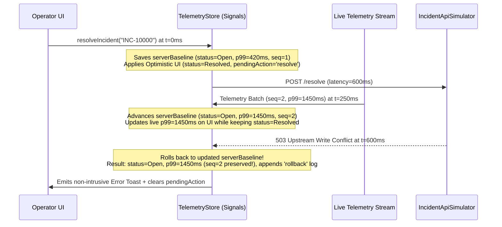

# Aegis Ops — Real-Time Operational & Incident Management Console

> Built with **Angular 22** (Standalone Architecture, Signals, `ChangeDetectionStrategy.OnPush`, `@angular/cdk/scrolling`, `@angular/cdk/a11y`, and **RxJS 7.8**) under strict TypeScript (`strict: true`, `strictTemplates: true`, zero `any`).  
> 📖 **Want a concrete, millisecond-by-millisecond runtime trace?** Read **[HOW_IT_WORKS.md](HOW_IT_WORKS.md)**.

**Aegis Ops** is a high-density SRE & operational incident triage console engineered to ingest, deduplicate, reconcile, filter, and render **10,000+ active and historical incidents at 60 FPS**—even during **1,000 events/sec** telemetry storms, WebSocket disconnects, out-of-order network partitions, and transient upstream write failures.

---

## Table of Contents

1. [Why This Project Exists](#1-why-this-project-exists)
2. [System Architecture & Data Flow](#2-system-architecture--data-flow)
3. [Deep Dive: Core Engineering Subsystems](#3-deep-dive-core-engineering-subsystems)
   - [3.1 Telemetry Stream Simulator & `bufferTime(100)` Backpressure](#31-telemetry-stream-simulator--buffertime100-backpressure)
   - [3.2 Bounded `O(1)` Event Deduplication (`BoundedEventIdSet`)](#32-bounded-o1-event-deduplication-boundedeventidset)
   - [3.3 Causal Out-of-Order Sequence Reconciliation](#33-causal-out-of-order-sequence-reconciliation)
   - [3.4 Optimistic Mutations & Concurrent-Telemetry-Safe Rollback](#34-optimistic-mutations--concurrent-telemetry-safe-rollback)
   - [3.5 Connection Resilience & Jittered Exponential Backoff](#35-connection-resilience--jittered-exponential-backoff)
   - [3.6 10,000+ Row Virtualized Queue & Multi-Facet Computed Signals](#36-10000-row-virtualized-queue--multi-facet-computed-signals)
   - [3.7 Bidirectional Layout (`dir="ltr" | "rtl"`) & WAI-ARIA Accessibility](#37-bidirectional-layout-dirltr--rtl--wai-aria-accessibility)
4. [Interactive Demo Guide: How to Test Every Feature](#4-interactive-demo-guide-how-to-test-every-feature)
5. [Keyboard Shortcuts & Triage Controls](#5-keyboard-shortcuts--triage-controls)
6. [Project Structure & File-by-File Guide](#6-project-structure--file-by-file-guide)
7. [Testing Strategy & Verification Suite](#7-testing-strategy--verification-suite)
8. [Architecture Decision Records (ADRs)](#8-architecture-decision-records-adrs)
9. [Getting Started & CLI Commands](#9-getting-started--cli-commands)

---

## 1. Why This Project Exists

Standard CRUD dashboards rarely stress-test browser rendering pipelines or frontend state invariants. Real-world operational consoles (like Datadog, PagerDuty, or Grafana OnCall) must solve four hard frontend systems problems simultaneously:

1. **High-Velocity Ingestion Without Main-Thread Starvation:** Pushing 1,000 WebSocket events/sec directly into reactive UI state triggers 1,000 array/map clones, filter/sort passes over 10,000+ records, and layout recalculations per second—freezing user input.
2. **Distributed Stream Anomalies:** At-least-once broker delivery produces **duplicate `eventId` frames** and **delayed out-of-order `sequence` frames** that can corrupt UI state if applied naively.
3. **Race Conditions Between Optimistic UI & Live Streams:** When an operator clicks _Acknowledge_ or _Resolve_, the UI must react in `<1ms`. If live stream metrics arrive while the HTTP write is in flight—and that HTTP write fails 600ms later—a naive snapshot rollback will accidentally erase the newer live stream data.
4. **Accessible, Direction-Agnostic High-Density UI:** Rendering 10,000+ interactive rows requires DOM virtualization, full keyboard navigation (`J`/`K`, arrows, `Enter`, `Esc`), modal focus trapping, screen-reader live regions, and **CSS Logical Properties** so LTR and RTL locales work identically without layout hacks.

---

## 2. System Architecture & Data Flow

### End-to-End Ingestion, Reconciliation & Rendering Pipeline

```mermaid
flowchart LR
  subgraph Transport["1. Asynchronous Stream & Chaos Layer (RxJS)"]
    Scheduler["20ms Fractional Tick Scheduler<br/>Paused (0/s) · Normal (5/s)<br/>Spike (250/s) · Burst (1000/s)"]
    Chaos["Chaos Fault Injector<br/>Duplicate eventId Replays &<br/>Stale Out-of-Order Sequences"]
    Gate["ConnectionResilienceService<br/>Transport Gate + Jittered<br/>Exponential Backoff"]
    Coalesce["bufferTime(100)<br/>Coalesces 1000 evt/s into<br/>≤ 10 Micro-Batches/sec"]
    Scheduler --> Chaos --> Gate --> Coalesce
  end

  subgraph Store["2. Synchronous State & Reconciliation Layer (Angular Signals)"]
    Ring["BoundedEventIdSet<br/>50,000-ID FIFO Ring<br/>O(1) Deduplication"]
    Reconcile["Pure Causal Reconciler<br/>lastSequence Gate &<br/>serverBaseline Advancement"]
    Primary["incidentMapState<br/>Signal&lt;ReadonlyMap&lt;string, Incident&gt;&gt;"]
    Derived["Computed Projections<br/>filteredIncidents · activeCriticalCount<br/>meanTimeToAckMs · selectedIncident"]
    Coalesce --> Ring --> Reconcile --> Primary --> Derived
  end

  subgraph View["3. OnPush Standalone Presentation Layer (LTR / RTL)"]
    KPI["KPI & Throughput Header<br/>Critical · MTTA · Ingest vs Batch · FPS"]
    Grid["CDK Virtual Scroll Viewport<br/>10,000+ Incidents · 52px Fixed Rows"]
    Drawer["Focus-Trapped Detail Drawer<br/>Causal Audit Log & Triage Actions"]
    Toast["Aria-Live Toast Stack<br/>Non-Intrusive Rollback Alerts"]
    Derived --> KPI
    Derived --> Grid
    Derived --> Drawer
  end

  Drawer -- "1. Immediate Optimistic Overlay (<1ms)" --> Primary
  Drawer -- "2. Async Write (300–800ms, ~15% Fail)" --> Api["IncidentApiSimulatorService"]
  Api -- "3a. 200 OK: Clear pendingAction & Bump Seq" --> Primary
  Api -- "3b. 503 Error: Restore serverBaseline" --> Primary
  Api -- "4. Push Error Alert" --> Toast
```



---

## 3. Deep Dive: Core Engineering Subsystems

### 3.1 Telemetry Stream Simulator & `bufferTime(100)` Backpressure

- **File:** `src/app/core/services/incident-stream-simulator.service.ts`
- **Initial Scale:** On startup, `generateSeedIncidents(10_000)` constructs 10,000 realistic operational incidents across 10 microservices (`payments-gateway`, `auth-edge-proxy`, `kafka-ingest-eu`, `ledger-settlement`, etc.) and 6 cloud regions (`us-east-1`, `eu-central-1`, `me-central-1`, etc.) so virtual scroll performance is testable immediately.
- **Fractional-Carry Scheduler:** A `20ms` timer tick (`50 ticks/sec`) uses fractional carry accumulation to emit exact event rates across four presets:
  - `Paused`: `0 events/sec`
  - `Normal`: `5 events/sec` (`1 event` every `200ms`)
  - `Spike`: `250 events/sec` (`5 events` every `20ms`)
  - `Burst`: `1,000 events/sec` (`20 events` every `20ms`)
- **Backpressure Coalescing:** Raw events emit on `rawEvents$` and pass through:
  ```ts
  this.rawEventSubject.pipe(
    filter(() => this.resilience.isConnected()),
    bufferTime(100),
    filter((batch): batch is TelemetryEvent[] => batch.length > 0),
    share(),
  );
  ```
  Even during a **1,000 events/sec** burst, Angular's Signal graph receives **at most 10 batch commits per second** (~100 events per batch), preserving ~16.6ms frame budgets for 60 FPS scrolling and interaction.

### 3.2 Bounded `O(1)` Event Deduplication (`BoundedEventIdSet`)

- **File:** `src/app/core/store/incident-reconciler.ts`
- Keeping an unbounded `Set<string>` of seen `eventId`s at 1,000 events/sec leaks ~3.6 million strings per hour.
- `BoundedEventIdSet` leverages JavaScript `Set` insertion-order iteration to maintain a **50,000-entry sliding FIFO window**:
  - `has(eventId)` runs in `O(1)`.
  - When `size >= 50,000`, `this.ids.values().next().value` evicts the oldest `eventId` in `O(1)`.
  - Duplicate packets increment the live `duplicatesDropped` telemetry counter without mutating incident state.

### 3.3 Causal Out-of-Order Sequence Reconciliation

- **File:** `src/app/core/store/incident-reconciler.ts`
- Every `Incident` tracks a monotonically increasing `lastSequence` integer, and every wire `TelemetryEvent` carries an `incidentId` and causal `sequence`.
- **Forward Event (`event.sequence > incident.lastSequence`):** Updates `severity`, `status`, `assignee`, `metrics`, `updatedAt`, and advances `lastSequence = event.sequence`.
- **Out-of-Order Event (`event.sequence <= incident.lastSequence`):**
  - Recognizes the packet as a delayed arrival from a lagging broker/collector partition.
  - **Never regresses** newer `status` (e.g., won't flip a `Resolved` or `Investigating` incident back to `Open`), `severity`, `assignee`, or `metrics`.
  - Preserves full observability by inserting an audit entry (`kind: 'reconciled-out-of-order'`) into `incident.timeline` sorted causally by `(sequence, timestamp)` and incrementing `outOfOrderReconciled`.

### 3.4 Optimistic Mutations & Concurrent-Telemetry-Safe Rollback

- **Files:** `src/app/core/store/telemetry-store.service.ts`, `src/app/core/services/incident-api-simulator.service.ts`
- Operators can **Acknowledge**, **Assign**, or **Resolve** incidents from either the row quick-actions or the Detail Drawer.
- `IncidentApiSimulatorService` simulates realistic network latency (**300–800ms**) and an organic **~15% upstream write failure rate** (plus a deterministic **Force Next Rollback** button in the Chaos Toolbar).
- **Solving Concurrent Stream + Rollback Races (`serverBaseline`):**



### 3.5 Connection Resilience & Jittered Exponential Backoff

- **File:** `src/app/core/services/connection-resilience.service.ts`
- Simulates WebSocket transport drops and automatic reconnection using bounded exponential backoff with ±12% jitter to prevent thundering-herd reconnect storms:
  $$\text{delay} = \min\left(\text{maxDelay}, \text{baseDelay} \cdot 2^{\text{attempt}-1}\right) \pm 12\%\text{ jitter}$$
- Drives a live `100ms` countdown Signal (`nextRetryInMs`, `attempt`, `currentBackoffDelayMs`) displayed in an assertive `role="alert"` status banner (`Attempt #1 (1.0s) → Attempt #2 (2.0s) → Attempt #3 (4.0s) → Connected`), with a manual **Force Reconnect** override.

### 3.6 10,000+ Row Virtualized Queue & Multi-Facet Computed Signals

- **Files:** `src/app/features/incident-console/components/incident-virtual-table/incident-virtual-table.component.ts`, `src/app/core/store/telemetry-store.service.ts`
- Uses `@angular/cdk/scrolling` (`<cdk-virtual-scroll-viewport itemSize="52">`) so only ~15–25 DOM rows exist at any moment regardless of whether 10,000 or 25,000 incidents are in memory.
- Multi-facet filtering combines:
  - **Severity Facet:** `Critical`, `High`, `Medium`, `Low`
  - **Status Facet:** `Open`, `Investigating`, `Resolved`
  - **Debounced Keyword Search:** `180ms` RxJS `debounceTime` + `distinctUntilChanged` bridged into `debouncedSearchQuery` Signal, matching across `id`, `title`, `service`, `region`, `assignee`, and `tags`.
  - **Deterministic Multi-Column Sorting:** Sortable by `Updated`, `Severity` (weighted rank + recency tie-breaker), `ID / Created`, and `P99 Latency`.

### 3.7 Bidirectional Layout (`dir="ltr" | "rtl"`) & WAI-ARIA Accessibility

- **Zero Physical Directional CSS:** Every component uses **CSS Logical Properties** (`padding-inline`, `padding-block`, `margin-inline-start`, `inset-inline-end`, `border-inline-start`, `inline-size`, `block-size`, `text-align: start`).
- Toggling `dir="ltr"` ↔ `dir="rtl"` in the header dynamically updates `<html dir="...">` via `DirectionService`:
  - KPI card accent borders flip cleanly from left to right via `border-inline-start`.
  - Toast stack relocates from bottom-right to bottom-left via `inset-inline-end`.
  - Detail Drawer slides in from the inline-end edge (`right` in LTR, `left` in RTL) with mirrored CSS keyframes.
- **Strict Accessibility:**
  - `@angular/cdk/a11y` `CdkTrapFocus` traps Tab/Shift+Tab inside the open Detail Drawer and automatically restores focus to the originating trigger element on close.
  - `aria-sort` on sortable grid headers, `aria-selected` on virtualized rows, `aria-pressed` on toggle controls, `role="status"` / `aria-live="polite"` on the toast viewport, and `role="alert"` / `aria-live="assertive"` on the disconnect banner.

---

## 4. Interactive Demo Guide: How to Test Every Feature

Once the app is running at `http://localhost:4200`:

1. **Stress-Test 1,000 Events/Sec Backpressure:**
   - In the **Chaos Toolbar**, switch **Stream Rate** from `Normal (5/s)` → `Burst (1000/s)`.
   - Watch the **KPI Header**: _Ingest Rate_ climbs to `~1,000 evt/s`, while _Render Batches_ stays locked at `10 batch/s (~100 evt/batch)` and _UI Frame Rate_ remains at `60 FPS` while scrolling 10,000+ virtualized rows.
2. **Verify Deduplication & Out-of-Order Reconciliation:**
   - Click **⇄ Inject Out-of-Order / Duplicate Burst** (or toggle **Continuous Chaos: ON**).
   - Observe `Dedup` and `OOO` counters increment immediately in the _Stream Integrity_ KPI card.
   - Open an affected incident's drawer to see amber-highlighted `[Out-of-order seq #...]` entries reconciled in causal order without regressing newer incident status.
3. **Test Exponential Backoff Disconnect / Reconnect:**
   - Click **⚡ Simulate Disconnect**.
   - Observe the red/amber **TRANSPORT OFFLINE** banner count down through exponential backoff attempts (`#1` → `#2` → `#3` → automatic recovery), or click **Force Reconnect** at any time.
4. **Test Optimistic UI & Deterministic Failure Rollback:**
   - Click **Force Next Rollback** in the Chaos Toolbar so it reads `ARMED` (or rely on the default `15% Auto` failure rate).
   - Click **Ack** or **Resolve** on any open incident row (or inside the Detail Drawer).
   - Watch the status badge immediately switch to spinning `Acking…` / `Resolving…` (`<1ms`), then after `300–800ms` cleanly roll back to its prior status, log a crimson `rollback` audit entry in the drawer timeline, and display a non-intrusive error toast.
5. **Test Bidirectional RTL Mode & Keyboard Triage:**
   - Click **`⇄ dir="ltr"`** in the top-right header to flip the entire console into **`dir="rtl"`**.
   - Press `J` / `K` (or `↓` / `↑`) to traverse the virtualized queue, `Enter` to open the focus-trapped drawer, and `Esc` to close it and restore focus.

---

## 5. Keyboard Shortcuts & Triage Controls

| Shortcut              | Action                                                                         |
| :-------------------- | :----------------------------------------------------------------------------- |
| `J` or `ArrowDown`    | Select next incident in the filtered virtual queue (auto-scrolls viewport)     |
| `K` or `ArrowUp`      | Select previous incident in the filtered virtual queue (auto-scrolls viewport) |
| `Enter`               | Open the Incident Detail Drawer for the currently selected row                 |
| `Escape`              | Close the Incident Detail Drawer (restores focus) or blur active search input  |
| `/`                   | Focus the debounced keyword search bar                                         |
| `Tab` / `Shift + Tab` | Navigate interactive controls (trapped inside Detail Drawer when open)         |

---

## 6. Project Structure & File-by-File Guide

```text
aegis-ops/
├── docs/
│   └── adr/
│       ├── 001-signal-rxjs-backpressure.md            # ADR: Hybrid RxJS bufferTime(100) + Angular Signals
│       └── 002-optimistic-updates-reconciliation.md   # ADR: serverBaseline rollback & causal sequence gate
├── src/
│   ├── index.html                                     # Root HTML shell (dir="ltr" default)
│   ├── styles.css                                     # Dark SRE theme tokens, tabular-nums & scrollbar styles
│   └── app/
│       ├── app.ts                                     # Root OnPush standalone component
│       ├── app.routes.ts                              # Route config mounting IncidentConsolePageComponent
│       ├── app.spec.ts                                # Root component + LTR/RTL DirectionService tests
│       │
│       ├── core/                                      # Domain Models, Stream Engine, Resilience & Signal Store
│       │   ├── index.ts                               # Core barrel exports
│       │   ├── models/
│       │   │   └── incident.model.ts                  # Strict domain, wire event, mutation & KPI interfaces
│       │   ├── services/
│       │   │   ├── connection-resilience.service.ts   # Jittered exponential backoff & countdown state
│       │   │   ├── direction.service.ts               # Document-level LTR/RTL signal synchronization
│       │   │   ├── incident-api-simulator.service.ts  # 300–800ms latency + ~15% write conflict simulator
│       │   │   ├── incident-stream-simulator.service.ts # 10k seed generator + RxJS bufferTime(100) engine
│       │   │   └── toast.service.ts                   # Non-intrusive notification queue (capped at 5 active)
│       │   └── store/
│       │       ├── incident-reconciler.ts             # Pure BoundedEventIdSet, causal reconciler & facet sorter
│       │       ├── incident-reconciler.spec.ts        # Unit tests for pure deduplication & causal ordering
│       │       ├── telemetry-store.service.ts         # Signal store, computed KPIs/facets, optimistic rollback
│       │       └── telemetry-store.service.spec.ts    # Unit tests for store, rollback, debounce & backoff
│       │
│       ├── features/
│       │   └── incident-console/                      # Feature-Sliced Incident Console Module
│       │       ├── incident-console-page.component.ts # Smart container & global keyboard triage controller
│       │       └── components/
│       │           ├── kpi-header/                    # Live Critical count, MTTA, ingest/batch rate & FPS cards
│       │           ├── chaos-toolbar/                 # Rate presets, fault injection & backoff alert banner
│       │           ├── filter-bar/                    # Severity/Status facet pills & debounced search input
│       │           ├── incident-virtual-table/        # @angular/cdk/scrolling 10,000+ row virtualized grid
│       │           └── incident-detail-drawer/        # Optimistic Ack/Assign/Resolve & causal timeline log
│       │
│       └── shared/
│           └── ui/                                    # Reusable Accessible Direction-Aware UI Primitives
│               ├── index.ts                           # Shared UI barrel exports
│               ├── badge/                             # Severity, Status & Pending spinner badge primitive
│               ├── drawer/                            # CdkTrapFocus modal drawer with RTL slide & focus restore
│               ├── toast-stack/                       # Polite/Assertive live-region notification stack
│               └── direction-toggle/                  # Accessible dir="ltr" | "rtl" header switch
```

---

## 7. Testing Strategy & Verification Suite

Unit tests are executed with **Vitest 4** and Angular `TestBed` (`npm run test:ci`), using deterministic fake timers (`vi.useFakeTimers()`) so latency, debouncing, and backoff windows run in milliseconds:

1. **`src/app/core/store/incident-reconciler.spec.ts` (5 specs)**
   - Verifies `BoundedEventIdSet` FIFO eviction when capacity is exceeded.
   - Verifies duplicate `eventId` dropping both intra-batch and inter-batch.
   - Verifies out-of-order stale `sequence` events do **not** overwrite newer `status`, `severity`, `assignee`, or `metrics`, while inserting `reconciled-out-of-order` entries in causal order.
   - Verifies forward stream telemetry during an in-flight mutation advances `serverBaseline` without clobbering optimistic UI state.
   - Verifies multi-facet filtering and weighted severity sorting.
2. **`src/app/core/store/telemetry-store.service.spec.ts` (7 specs)**
   - Verifies store-level `duplicatesDropped` and `outOfOrderReconciled` counters.
   - Verifies `<1ms` optimistic **Acknowledge** update and clean confirmation after simulated network latency.
   - Verifies optimistic **Resolve** rollback on simulated `503` failure, confirming **concurrent stream telemetry received mid-flight is preserved** and an error toast is pushed.
   - Verifies `activeCriticalCount` and `meanTimeToAckMs` (MTTA) computed KPI Signals.
   - Verifies multi-facet filtering + `180ms` debounced keyword search Signal timing.
   - Verifies multi-column ascending/descending sort toggling.
   - Verifies `bufferTime(100)` burst coalescing and `ConnectionResilienceService` disconnect gating + exponential backoff progression (`1000ms` → `2000ms` → recovery).
3. **`src/app/app.spec.ts` (2 specs)**
   - Verifies standalone application bootstrap and `DirectionService` synchronization with `<html dir="ltr|rtl">`.

---

## 8. Architecture Decision Records (ADRs)

Full engineering context, alternatives considered, and trade-offs are documented in `docs/adr/`:

- **[ADR 001 — Coalescing High-Frequency RxJS Telemetry into Angular Signals via `bufferTime(100)`](docs/adr/001-signal-rxjs-backpressure.md)**  
  Explains why raw asynchronous event streams use RxJS time-window operators before crossing into synchronous Angular Signals, capping store updates at 10 Hz while bounding deduplication memory to 50,000 IDs.
- **[ADR 002 — Optimistic Operator Mutations, Concurrent Telemetry Baseline Advancement, and Causal Reconciliation](docs/adr/002-optimistic-updates-reconciliation.md)**  
  Details how `inFlightMutations` separates optimistic UI overlays from `serverBaseline` truth so failed writes never clobber concurrent live telemetry, alongside per-entity causal sequence gating.

---

## 9. Getting Started & CLI Commands

### Prerequisites

- **Node.js** `>= 20.x`
- **npm** `>= 10.x`

### Install Dependencies

```bash
npm install
```

### Start Development Server

```bash
npm start
```

Navigate to `http://localhost:4200` — hot reload is enabled.

### Run Unit Tests

```bash
# Single CI run (Vitest)
npm run test:ci

# Interactive watch mode
npm test
```

### Build Production Bundle

```bash
npm run build
```

Build artifacts are emitted to `dist/aegis-ops/`.
